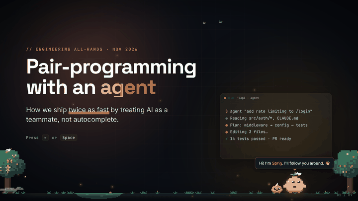
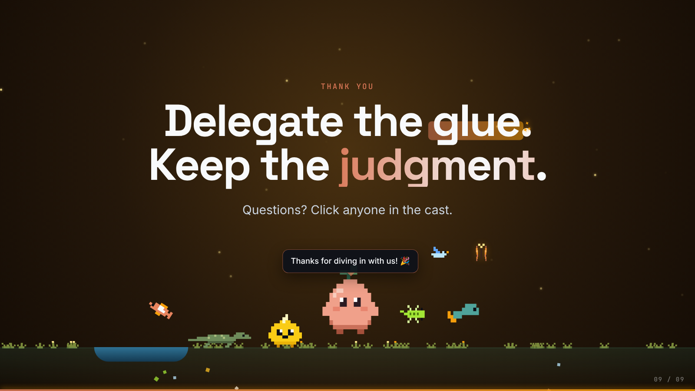

# Peapod

**A little pod of pixel friends who present your slides.** Sprig, a tiny seed with a sprout, hops along the bottom of every slide, through a pixel garden full of critters. Birds land on Sprig's head, a koi leaps from the pond, a monitor lizard and a snake wander by, and Zip follows Sprig everywhere.



One HTML file. No build step. Open it and press →.

**[▶ Live demo](https://nzzl.github.io/peapod-deck/)** · **[▶ Zoom version](https://nzzl.github.io/peapod-deck/zoom-deck.html)**

## What's inside

| File | What it is |
|---|---|
| `index.html` | **The Peapod deck.** Nine slides with kinetic text, three live interactive slides, and the garden cast along the bottom. |
| `zoom-deck.html` | **The zoom version** of the same talk. Instead of changing slides, the camera dives into an object on each slide and the next one opens out of it. |

Both decks use the same sample talk, *Pair-programming with an agent*, so you can see every feature in action. Replace it with your own content.

## Controls

| Key | Action |
|---|---|
| `→` / `Space` | Next beat or slide |
| `←` | Previous beat or slide |
| `F` | Full screen |
| `R` | Replay the current slide |
| `N` | Presenter notes (hidden from the audience until you press it) |
| `Home` / `End` | Jump to the first / last slide |

Click any critter for a line.

## The garden

| Who | What they do |
|---|---|
| **Sprig**, a seed with a sprout | Hops to a new spot on every slide, jumps onto the thing you're talking about, and throws a confetti party at the end. Click for tips. |
| **Zip**, a spark sprite | Follows Sprig everywhere and cheers at the good bits. |
| **Two bluebirds** | Perch in the trees, swap branches, and sometimes land on Sprig's head. |
| **A koi** | Leaps out of the lily pond. |
| **Monty**, a monitor lizard | Strolls across, stops to flick his tongue, and swims through the pond. |
| **Noodle**, a snake | Slithers by and startles Zip. |
| **Gigi**, a gecko | Scurries up and down the tree trunks. |
| **A butterfly** | Visits the flowers and sometimes rests on Sprig. |

When nobody touches the keyboard for a while, Sprig gets up to something on its own: a stretch, a wave at Zip, or watching the birds.

Three slides are live and interactive: a before/after toggle, a clickable architecture explorer and an agent simulator with sliders.

## The zoom version


In `zoom-deck.html`, each slide lives inside an object on the previous one: a flower, a dewdrop, a bubble, a burrow, a knot hole, a spark, a porthole and the setting sun. Pressing → dives the camera through it. Each slide is presented by a different member of the cast, enlarged, who acts out the content: Noodle coils around the loop diagram and Gigi crawls to the node you click. `←` zooms back out.



## How it works

**A fixed stage.** Every slide is designed at 1920 × 1080 and scaled to fit the window, so all positions are in stage pixels and the layout never depends on screen size.

**Sprites from text.** Every character is a grid of characters plus a palette:

```js
// Gigi the gecko, seen from above
['..ggg..', '.kgggk.', '..ggg..', 'f.gsg.f', ...]   // { g: '#A3E635', k: '#0B0E14', ... }
```

A small helper turns each run of one colour into an SVG `<rect>` with `shape-rendering="crispEdges"`, so the art stays sharp at any size. Animation frames are separate `<g>` groups.

**Squash and stretch.** Sprig's hop is one GSAP timeline: squash to anticipate, move sideways at constant speed while rising and falling, stretch in the air, squash on landing, puff some dust, and settle with an elastic bounce. Every time Sprig moves, the garden hears about it, so Zip follows and perched birds fly off.

**Beats you can rewind.** Each slide has a `setStep(n, instant)` function that sets it to beat *n* from any direction. Going back jumps to the previous slide's last beat with animations skipped, so no reverse animations are needed.

**Nested portals (zoom version).** The next slide is mounted inside a circular portal on the current one, scaled down, so it shows as a live preview. A dive animates one camera element on a log scale while the circular clip widens. When it lands, the new slide is moved to the top level at normal size and the camera resets, so you can dive forever without losing sharpness.

## Make your own

1. **Change the talk:** edit the HTML inside each `<section class="slide">` and the `notes` in the `DEFS` list near the bottom of `index.html`. Add `data-step="n"` to anything that should appear on beat *n*, and wrap words in `<span class="hl">` for a highlighter sweep.
2. **Place Sprig:** each slide's entry in `DEFS` has a `spot`, the x position where Sprig lands.
3. **Add a critter:** draw a sprite grid, render it with `spriteSVG(...)`, and give it an idle loop. Use the koi or the gecko as a template.
4. **Or ask an AI:** paste `index.html` into your coding agent and describe your talk. Ask it to keep the slide structure and `setStep` pattern, and to check the result in a headless browser.

Keep the bottom ~150 px of each slide clear for the garden.

## Testing

```sh
npm install
npx playwright install chromium
npm test
```

The smoke test steps through every beat of both decks, forward to the finale and all the way back. It runs as a normal page and inside a sandboxed iframe, and fails on any script error. The same test runs in GitHub Actions on every push.

## Credits and licence

- Code and artwork: [MIT](LICENSE).
- Animation by [GSAP](https://gsap.com), loaded from cdnjs and covered by [its own licence](https://gsap.com/standard-license).
- Fonts: Space Grotesk, Inter and JetBrains Mono from Google Fonts (SIL Open Font License).
