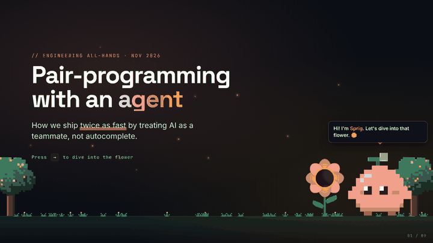

# Peapod

**A little pod of pixel friends who present your slides.** Instead of sliding to the next slide, the camera dives into an object on the current one, such as a flower, a dewdrop or the setting sun, and the next slide opens out of it. Each slide is presented by a different pixel-art character who acts out the content.



One HTML file. No build step. Open it and press →.

**[▶ Live demo](https://nzzl.github.io/peapod-deck/)**

## What's inside

| File | What it is |
|---|---|
| `index.html` | **The zoom-dive deck.** Nine scenes, each nested inside a portal in the previous one. |
| `garden-deck.html` | A classic slide-to-slide version of the same talk, with a garden full of animated critters along the bottom. |

Both decks use the same sample talk, *Pair-programming with an agent*, so you can see every feature in action. Replace it with your own content.


## Controls

| Key | Action |
|---|---|
| `→` / `Space` | Next beat, or dive into the next scene |
| `←` | Previous beat, or zoom back out |
| `F` | Full screen |
| `R` | Replay the current scene |
| `N` | Presenter notes (hidden from the audience until you press it) |
| `Home` / `End` | Jump to the first / last scene |

Click any character for a line. You can also click a glowing portal to dive in.

## The cast

| Scene | Presenter | What they do |
|---|---|---|
| Night garden | **Sprig**, a seed with a sprout | Waves you into the flower |
| Inside the flower | **Flutter**, a butterfly | Lands on the "glue work" bar |
| Underwater pond | **Kiko**, a koi | Flips when you switch to "Agent way" |
| Meadow | **Noodle**, a snake | Coils around the loop diagram |
| Tree bark | **Gigi**, a gecko | Crawls to the node you click |
| Lamp-lit den | **Monty**, a monitor lizard | Watches the prompt grow |
| Circuit world | **Zip**, a spark sprite | Cheers clean runs, panics at high risk |
| Dusk sky | **Blu**, a bluebird | Tweets at each takeaway |
| Golden finale | Everyone | A party |

Three slides are live and interactive: a before/after toggle, a clickable architecture explorer and an agent simulator with sliders.

## How it works

**Nested portals.** Each scene marks a circular portal with `data-portal="x,y,diameter,kind"`. The next scene is mounted inside that portal, scaled down, so the audience sees a live preview of it. Diving animates one camera element: the zoom factor is interpolated on a log scale, the portal's centre glides to the screen centre, and the circular clip widens until the new scene fills the stage.

**Re-rooting.** When a dive finishes, the new scene is moved to the top level at normal size and the camera resets. Nothing is ever more than one zoom deep, so you can dive forever without the floating-point blur and jitter that real infinite zooms run into.

**Sprites from text.** Every character is a grid of characters plus a palette:

```js
// Gigi the gecko, seen from above
['..ggg..', '.kgggk.', '..ggg..', 'f.gsg.f', ...]   // { g: '#A3E635', k: '#0B0E14', ... }
```

A small helper turns each run of one colour into an SVG `<rect>` with `shape-rendering="crispEdges"`, so the art stays sharp at any zoom. Animation frames are separate `<g>` groups.

**Beats you can rewind.** Each scene has a `setStep(n, instant)` function that sets it to beat *n* from any direction. Zooming back out jumps to the previous scene's last beat with animations skipped, so no reverse animations are needed.

## Make your own

1. **Change the talk:** edit the HTML inside each `<section class="scene">` and the `notes` in the `DEFS` list near the bottom of `index.html`.
2. **Move a portal:** change a scene's `data-portal` attribute. Kinds: `flower`, `dew`, `bubble`, `burrow`, `knot`, `spark`, `porthole`, `sun`.
3. **Add a character:** draw a sprite grid, render it with `spriteSVG(...)`, and place it with `makeActor(...)`. Use an existing presenter as a template.
4. **Or ask an AI:** paste `index.html` into your coding agent and describe your talk. Ask it to keep the scene structure, portals and `setStep` pattern, and to check the result in a headless browser.

Keep the bottom ~150 px of each scene clear for the presenters.

## Testing

```sh
npm install
npx playwright install chromium
npm test
```

The smoke test steps through every beat and dive of both decks, forward to the finale and all the way back. It runs as a normal page and inside a sandboxed iframe, and fails on any script error. The same test runs in GitHub Actions on every push.

## Credits and licence

- Code and artwork: [MIT](LICENSE).
- Animation by [GSAP](https://gsap.com), loaded from cdnjs and covered by [its own licence](https://gsap.com/standard-license).
- Fonts: Space Grotesk, Inter and JetBrains Mono from Google Fonts (SIL Open Font License).
